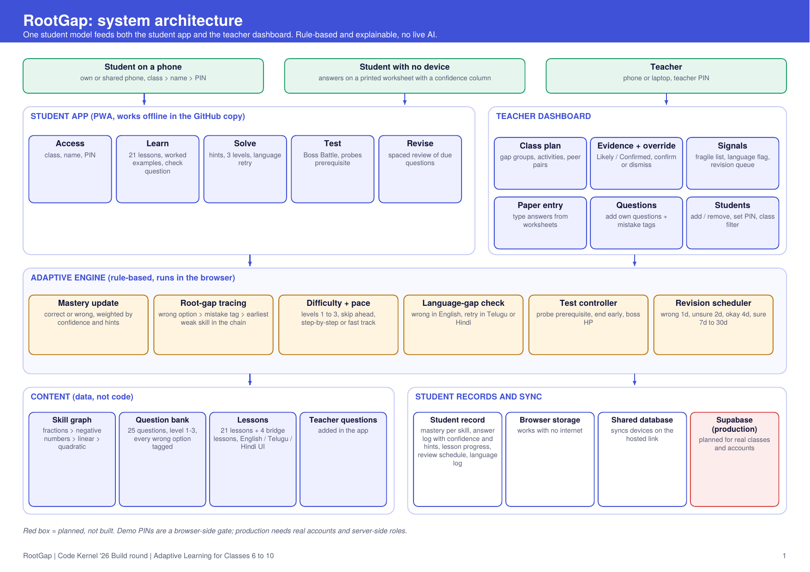
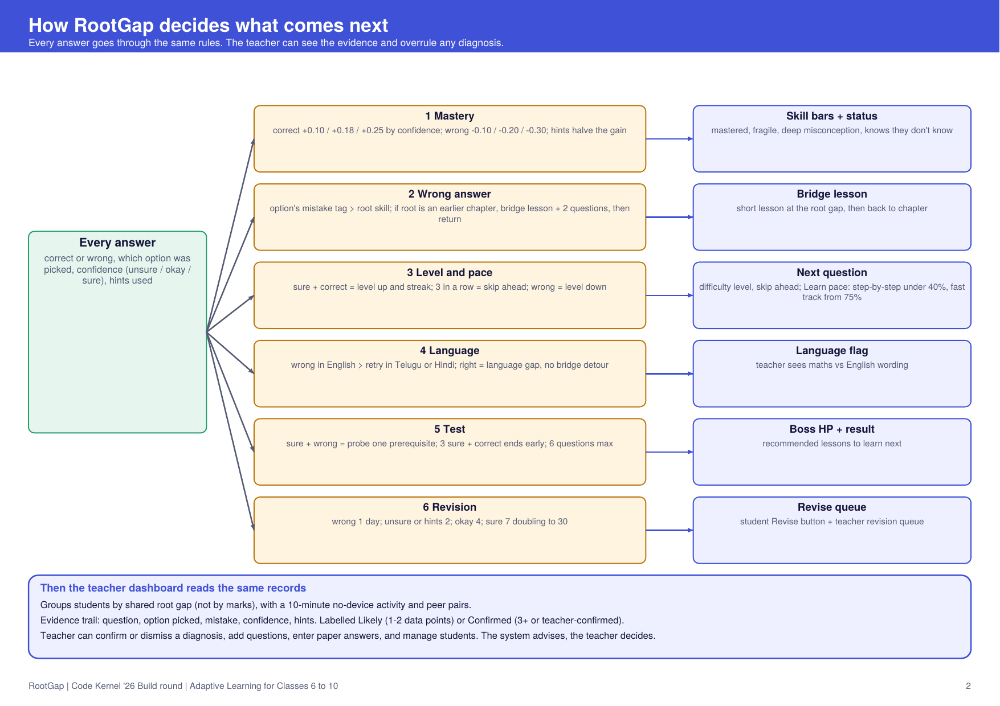

# RootGap: confidence-aware adaptive learning (Classes 6 to 10)

Code Kernel '26, Build round. A student taps how sure they were after every answer; a rule-based engine traces mistakes through a prerequisite graph (fractions > negative numbers > linear equations > quadratics) to the root gap, serves a bridge lesson (English / Telugu / Hindi), and gives the teacher gap-based groups, an evidence trail, a fragile list and override controls. A paper-entry grid covers students with no device.

Content: 25 tagged questions across 4 chapters (6 to 7 each), 4 bridge lessons, 3 languages.

## Architecture and how it decides what comes next

Short version: every answer carries correctness, the option picked (each wrong option is tagged with a mistake), a confidence tap and hints used. Rules update mastery, trace the mistake to a root skill in the prerequisite chain, set the next difficulty and pace, and schedule revision. The teacher dashboard reads the same records and shows the evidence, so a teacher can confirm or dismiss any diagnosis. Full PDF: `docs/RootGap_Architecture.pdf`.

## Explained on screen
After every answer the app shows a **🧭 Why this happens next** panel (mistake, root gap, level change, streak, revision date). Test ends with a **decision log** listing why each step happened.

## Targeted feedback and class-aware difficulty
A wrong answer now shows the specific mistake behind the option picked, how to fix it, and a step-by-step solution for that exact question (the full chapter lesson is one tap away). Every question has a class-appropriate level (1 to 3), and practice starts higher for students above the chapter's class (for example Class 10 on quadratics starts at level 2).

## App experience
Student sign-up with avatar and PIN, XP, levels, daily goal ring, badges, celebration effects, bottom navigation (Home, Learn, Practise, Revise, Me). Teacher: assign work to a class (with completion counts), add or edit or remove students, bulk add, and a demo button that simulates a class period so the dashboard updates live.

## What is built and what is not
Built: Learn (21 lessons), Solve (hints, levels, language retry), Test (Boss Battle, prerequisite probe), Revise (spaced review), teacher plan, evidence trail and override, paper entry, question editor, student management, English/Telugu/Hindi interface.
Not built: other subjects and most of the syllabus, real accounts and server-side security, tested offline mode on real phones, real classroom validation. Demo PINs: students 1111, teacher 1234.

## Run
Open `index.html`, or serve the folder (`npx serve .`). Deploy free on GitHub Pages / Netlify / Vercel (static, no build step).

## Modes
Student home has Learn (21 lessons across 4 chapters: fractions 7, negative numbers 5, linear equations 5, quadratics 4; each with explanation, worked example and a check question, progress saved per student), Solve (adaptive practice with bridge lessons) and Test (short adaptive test: probes a prerequisite after a confident wrong answer, ends early once three sure-and-correct answers appear, then recommends what to learn). Teachers manage students and questions from the Teacher tab.

## Adaptive features
- **Learn:** pace adapts per chapter (step-by-step for weak, fast-track skip-with-check for strong), recommended next lesson, board topic references.
- **Solve:** 3-level hint ladder (hints halve the mastery gain and are shown to the teacher), difficulty level moves up and down with answers, language retry (wrong in English, retry in Telugu/Hindi; a right answer flags a language gap, not a concept gap).
- **Test:** Boss Battle skin, prerequisite probing, early finish.
- **Teacher:** language flag card, hint usage in the evidence trail, class filter.
- **Revision scheduling:** wrong answers return after 1 day, unsure (fragile) or hint-assisted answers after 2 days, confident ones after 4, 7 and up to 30 days. Students get a Revise button when questions are due; teachers see a Revision queue card (with a demo fast-forward button to simulate days passing).
- **Sync:** on the claude.ai hosted version, student records sync across devices through the shared db (people need contributor access). In this GitHub copy the sync code is inactive; for production replace `sy()`, `syM()` and `syncInit()` with Supabase calls.

## Access (demo)
Students: choose class, then name, then PIN (demo PIN 1111 for everyone). Teacher tab needs the teacher PIN (demo 1234). Teachers add their own questions in Teacher > Questions. These PINs are a client-side demo gate only; production needs real accounts and server-side roles.

## Demo script (3 minutes)
1. Student tab > pick **Ravi** > answer Q1 (x - 2)(x + 3) = 0 with option A and tap sure > see the misconception and the Class 7 bridge lesson. Toggle Telugu and Hindi. The Adaptive path strip shows the full sequence.
2. Finish the 2 bridge questions > Ravi returns to quadratics.
3. Teacher tab > class plan: gap groups, 10-minute activity, peer pairs > click a student for the evidence trail > Dismiss / Confirm.
4. Fragile list > Paper entry tab (no-device mode).

## Notes
- Prototype data lives in browser localStorage with seeded sample students; production would sync via Supabase.
- Telugu and Hindi text must be reviewed by a teacher before real use.
- Engine: confidence-weighted mastery update, graph-based root-gap tracing, rule-based recommendations. No live AI.
